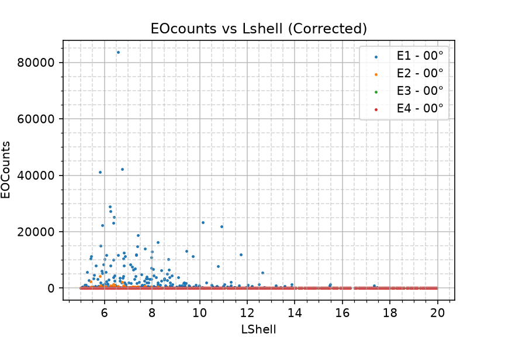
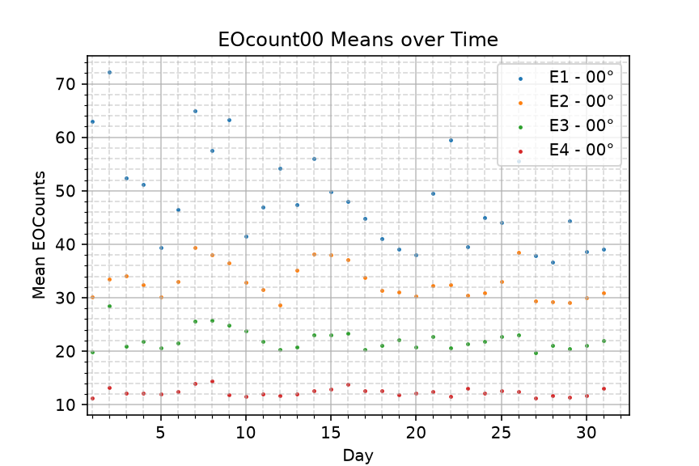

[Information on editing a Markdown document](https://docs.github.com/en/get-started/writing-on-github/getting-started-with-writing-and-formatting-on-github/basic-writing-and-formatting-syntax)

# Data

## Source

(1-2 paragraphs) Describe where the data came. If data are on-line, provide links.

The data of which I am analyzing for my final project is around 62 processed electron precipitation .nc arrays from the Medium Energy Proton/Electron Detector (MEPED) aboard the EUMETSAT MetOp Satellite. The base data was procured from the POES database on the NOAA Website at https://www.ncei.noaa.gov/data/poes-metop-space-environment-monitor/access/l1a/v01r00/2023/noaa15/, after which it was run through a python script to filter proton contamination and subsampled to a 16-second cadence. After 2012, the cadence for data collection was switched from a 16-second averaged count rate to 2-second averaged count rate. By subsampling, we can accurately analyze and compare each data set at the smallest interval that they both can run at. MetOp-02, the instrument I will be using, is one of 8 instruments utilized by MAPLE, the electron precipitation research project I am currently working at as a research assistant.

## Interpretation

(1-2 paragraphs) Describe what is measured at a basic level. Provide links to 1-2 high-level descriptions (web pages or papers). This should be a text version of your two-minute overview.

The MEPED instrument aboard the MetOp satellite contains 2 proton telescopes and 2 electron telescopes, each with 90-degree and 0-degree detectors. It has 6 proton channels and 3 electron channels (~ 25 keV to 2500 MeV), with the 6th proton channel being used to count relativistic electrons from instrument contamination. Each file represents one day of data collection, and by taking the mean of the electron counts in each channel for each file, we get an average for the entire day. From there, I can calculate the standard deviation of the data and find an appropriate conference interval. This is my plan for next week.

https://repository.library.noaa.gov/view/noaa/15751/noaa_15751_DS1.pdf

# Exploratory Data Analysis

Provide 1-3 plots that characterize general features of the data. These plots will be revised as you project progresses. The first version should be of what you presented the first time.

This was my first image of my first draft of my final project. It depicts the processed data from the NOAA-19 (n19) instrument aboard the POES Satellite. After realizing that I did not have enough data from the n19 instrument to perform a meaningful statistical analysis, I decided to pivot to the MetOp-02

# Statistical Test

## Description

Explain what you want to quantify with statistical methods. Provide references to any equations used.

You can use plain text for equations, e.g., y=mx+b, or LaTeX, e.g., $y=mx+b$.

## Results

Present the results of your analysis. Include tables and plots.

# References

Add references to any web page or paper that you read as you worked on this project.

Example:

* [Wheatland, 2000](https://iopscience.iop.org/article/10.1086/312739/pdf)

# Grading

Final project presentations, 4:30-7:10 pm in the same room as class. [Final Exam Schedule](https://registrar.gmu.edu/fall-2026-final-exam-schedule/)

Project presentations (10-20 minutes)

Guidelines:
1. Present exploratory data analysis results that are relevant to part 2.
2. Discuss question that you want to answer that requires statistical methods. Discuss related literature, if relevant.
3. Review theory
4. Present results related to question

You may use PPT or present from your README.md file.

Grading:
* All revisions discussed during previous class presentations addressed
* Theory correct
* Results correct
